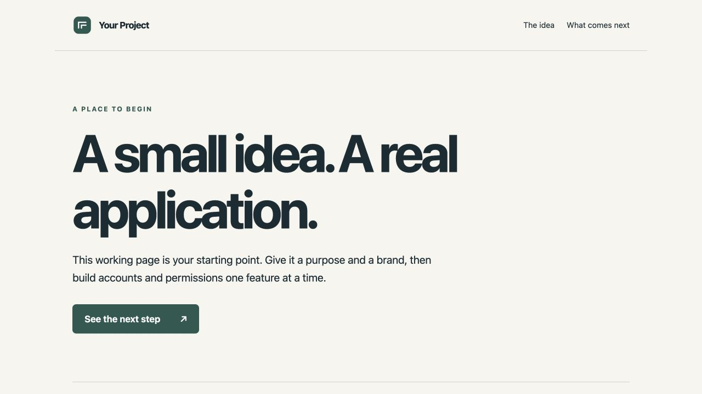
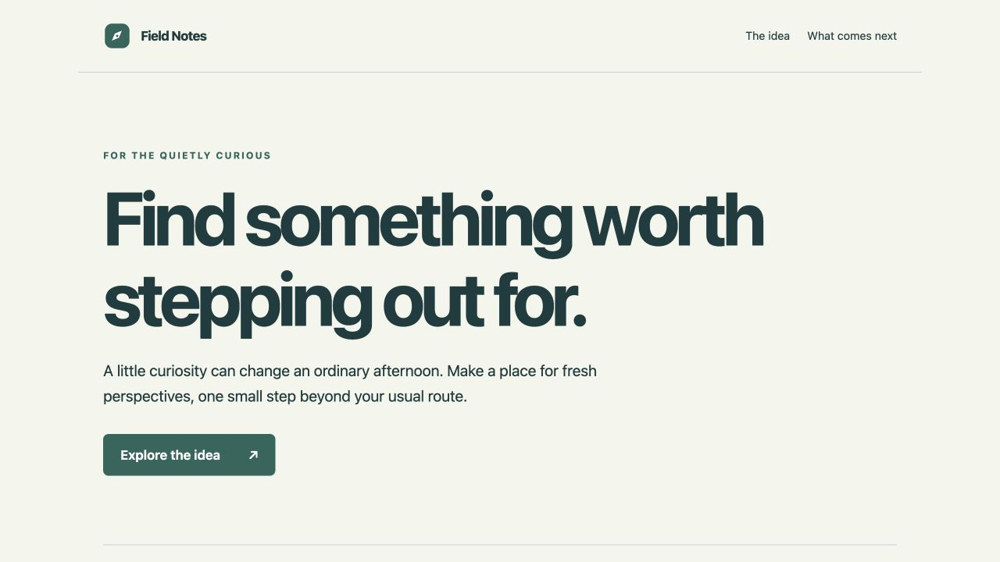
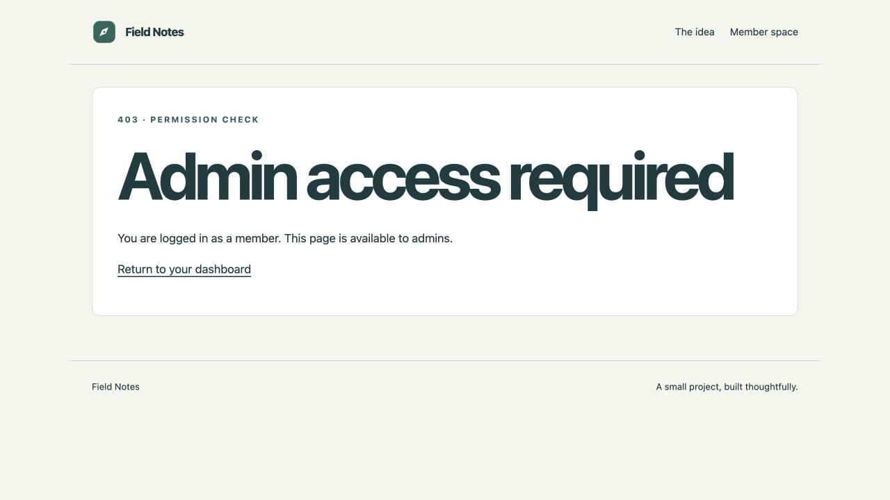
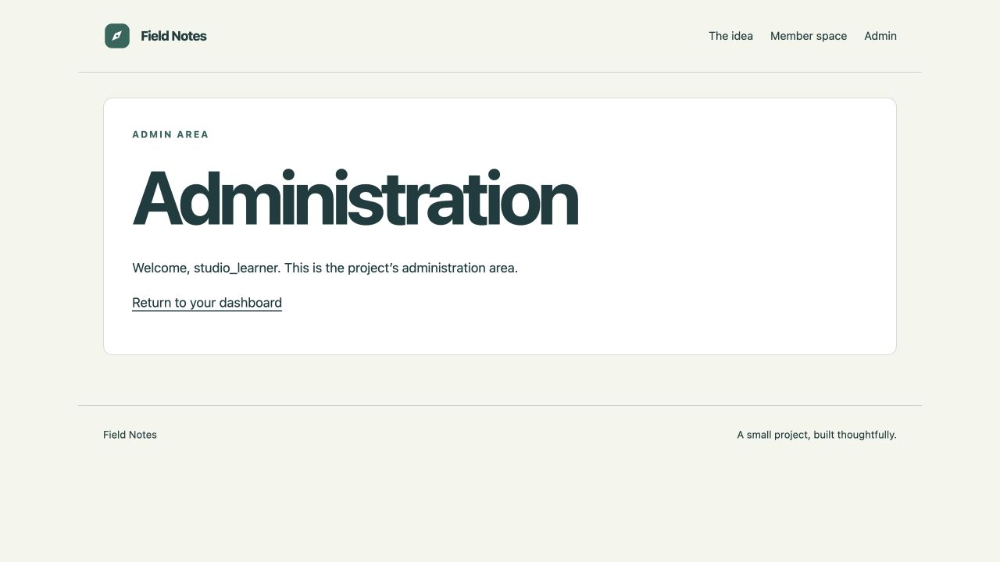

# Fresh SSH student walkthrough · October 27, 2026

**Result:** the three local app lessons were completed in a disposable template
copy. Each lesson had its own issue, reviewed PR, full checks, merge and closed
issue. A second untouched SSH clone confirmed the unfinished starting point.

**Method and limits:** terminal commands, dependency installs, browser actions,
tests and GitHub operations were real. A separate model supplied learner replies
to actual states provided by the instructor coach. The implementation adopted
the published worked examples, with the assistance disclosed. This is a
simulation of coaching and workflow, not independent student coding, a human
usability study or proof of learning. ChatGPT desktop's project-selection UI was
not controlled or validated by this evaluation.

## What was actually tried

1. Created a GitHub template copy with only main and SSH-cloned it. The first
   copy was briefly empty; waiting for its files and pulling main recovered it
   without inventing missing source files.
2. Connected the local project context, confirmed its own SSH remote and Python,
   then ran setup into a new environment. macOS used Python 3.14.7; Linux and
   Windows CI used Python 3.12. No local Docker, Node or provider API key was needed.
3. Ran the neutral page and foundation checks. The synthetic learner noticed
   that it did not yet explain a specific app. Accounts and roles remained absent.
4. Completed APP-001, APP-002 and APP-003 in order, preserving a prediction before
   the plan, interpretation of an actual check, supplied-UI observation, keep
   reason and accuracy review. Synthetic contributions and assistance were labeled;
   no human contributions are claimed.
5. Reviewed the actual browser at desktop and narrow widths through prepared
   Chromium checks; manually exercised signup, wrong/correct login, logout,
   direct role denial, promotion and downgrade using Computer Use.
6. Created a second template copy after the fixes, waited for its files, then
   SSH-cloned and set it up independently. All tracked files matched template
   revision `2334056`. It passed 98 foundation cases and two real browser
   journeys, with marker zero and empty account/role routers. Its explicit
   unfinished APP-001 acceptance check correctly failed.

The student terminal path was SSH Git plus `studio.py`. Instructor GitHub
connectors and an existing instructor CLI handled repository administration;
students do not need to install another GitHub CLI.

## Published trial evidence

[Completed synthetic LEARNING.md](https://github.com/kaw393939/is373-app-trial-1027/blob/main/LEARNING.md)
and [SPEC.md](https://github.com/kaw393939/is373-app-trial-1027/blob/main/SPEC.md)
preserve the short decisions, assistance and actual implementation links.

| Lesson | Real scope and local full checks | Own issue / PR | PR CI / merged revision CI | Selected-revision status |
|---|---|---|---|---|
| APP-001 | Field Notes homepage; 93 foundation + 2 homepage cases + 2 Chromium journeys | [#1](https://github.com/kaw393939/is373-app-trial-1027/issues/1) / [#2](https://github.com/kaw393939/is373-app-trial-1027/pull/2) | [PR](https://github.com/kaw393939/is373-app-trial-1027/actions/runs/40527928157) / [main](https://github.com/kaw393939/is373-app-trial-1027/actions/runs/40528407530) | [Snapshot](app-001-evidence.json), `3186909` |
| APP-002 | Account flow; 98 foundation + 14 cumulative contracts + 2 Chromium journeys | [#3](https://github.com/kaw393939/is373-app-trial-1027/issues/3) / [#4](https://github.com/kaw393939/is373-app-trial-1027/pull/4) | [PR](https://github.com/kaw393939/is373-app-trial-1027/actions/runs/40530072858) / [main](https://github.com/kaw393939/is373-app-trial-1027/actions/runs/40530663496) | [Snapshot](app-002-evidence.json), `6179918` |
| APP-003 | Server roles; 98 foundation + 18 cumulative contracts + 2 Chromium journeys | [#5](https://github.com/kaw393939/is373-app-trial-1027/issues/5) / [#6](https://github.com/kaw393939/is373-app-trial-1027/pull/6) | [PR](https://github.com/kaw393939/is373-app-trial-1027/actions/runs/40532761406) / [main](https://github.com/kaw393939/is373-app-trial-1027/actions/runs/40533378370) | [Snapshot](app-003-evidence.json), `800238c` |

Both required jobs, `check` and `windows`, passed at every selected publication.
Snapshots were taken on clean local main at each merge, before the next lesson
changed its revision. They establish recorded presence and checked publication,
not human understanding. Counts are pytest cases, each of which can contain
several assertions; the early trial's loose word “assertions” is not an assertion
count or grading target. Checks grew during maintenance, so totals differ by stage.

The final Windows stage ran 96 foundation cases with two documented POSIX-only
skips, all 18 feature cases and two actual Chromium journeys. Actual Windows
DACL checks passed; Windows permissions were not inferred from POSIX mode bits.

## Friction found and fixed

| Finding | Change and actual follow-through |
|---|---|
| The public page can show Sign in instead of a usable template action | README explicitly starts with signing into GitHub. The final public-browser check was logged out; repository administration used the authenticated connector/CLI. |
| An empty generated repository could look like a broken clone | README waits for files and gives the untouched-clone pull recovery. The first trial exercised it; the retry waited and cloned populated files. |
| A green foundation could be mistaken for completed accounts | Default output names all pending lessons. Explicit unfinished contracts fail, and status requires the declared stage plus a current full receipt. |
| “See the next step” was vague on a branded page | Synthetic feedback selected “Explore the idea.” The actual browser reached its explanation. The prepared journey now tests a real destination rather than freezing the original wording; signup/unknown-route rejection remains checked. |
| Live polling flooded the terminal | Development access logging is quiet; startup, restart and error messages remain. |
| Ctrl+C followed by an immediate restart falsely reported a busy port | POSIX preflight now handles TIME_WAIT. Real immediate default/plain restarts succeeded; an actual occupied listener still fails. Windows does not receive unsafe shared-address behavior. |
| Plain preview instructions hid a distinction | README says template/CSS edits need refresh and Python edits need restart. Actual plain-mode template changes waited for refresh; Python health behavior stayed unchanged before restart. Default saved edits restarted/refreshed. |
| Progress suggested closing an already closed issue while CI ran | It now says to wait for the actual pending jobs, fix failed jobs, review/merge, or close an open issue as appropriate. APP-002 exercised the corrected pending message. |
| Wrong-password recovery cleared both fields | The worked account router now retains only a validated username; passwords stay blank. Actual browser retry and negative request contracts passed. |
| Malformed non-ASCII CSRF input produced a server error | The prepared helper now rejects it with 403. Helper and actual HTML-route regressions passed. |
| Windows console/ACL evidence needed real platform checks | UTF-8 output and strict DACL parsing were corrected. Linux and Windows CI verify setup, private storage, tests and Chromium. |
| A drawn page might be expected to change immediately after a role command | The lesson asks for a new request/refresh. Actual promotion and downgrade changed access within the same login. |
| Later accuracy reviews could feel repetitive | The final synthetic learner identified this. Coaching now previews only new learner words/help and reuses the onboarding notice, while retaining review before publication. |

[Initial build and security checks](https://github.com/kaw393939/is373-app-studio/pull/2)
and [walkthrough fixes](https://github.com/kaw393939/is373-app-studio/pull/3)
preserve the maintenance trail. The
[separate passive-coaching evaluation](coaching-eval-2026-10-27.md) includes
repeated “yes”/“do everything,” partial predictions and honest remaining gaps.
Those probes cannot guarantee another agent's behavior or measure student engagement.

## Useful visual evidence

Final untouched template, still unfinished:

APP-001 worked trial after the learner's CTA revision:

Same account/session: member denied, then trusted promotion allowed access.
The subsequent downgrade returned the denial again.

Additional actual views: [CTA destination](assets/homepage-action.png),
[member dashboard](assets/member-dashboard.png), and
[corrected login retry](assets/login-recovery.png).

## What remains ready for class

- [Main template](https://github.com/kaw393939/is373-app-studio) remains neutral
  at marker zero, with empty account/role routers and pending active LEARNING
  fields. Its README is the one starting path.
- Cumulative [APP-001](https://github.com/kaw393939/is373-app-studio/tree/reference/app-001),
  [APP-002](https://github.com/kaw393939/is373-app-studio/tree/reference/app-002) and
  [APP-003](https://github.com/kaw393939/is373-app-studio/tree/reference/app-003)
  references retain pending learner records and explicit instructor headers.
  [Current-head CI evidence](reference-evidence.json) records both successful
  jobs on every reference.
- [Fresh-template evidence](fresh-template-evidence.json) records the separate
  retry; that was a foundation smoke check, not another completed assignment.
- [Server Studio's handoff](https://github.com/kaw393939/373_hosting/pull/13)
  now points to this app repository. Its [main checks](https://github.com/kaw393939/373_hosting/actions/runs/40528116436)
  passed. No live server deployment or production auth certification is claimed.
- Both disposable GitHub repositories are archived, preserving issues, PRs and
  evidence. Their clean local checkouts were moved under `.studio-trials`;
  temporary environments, private runtime databases/keys and caches were removed.
  The duplicate solution staging and clean reference worktree were removed.
  All trial/preview servers were stopped; no listeners remained on the owned
  ports 8000, 8001, 8002 and 8040. The instructor source environment remains available.

The next useful evaluation is a real student's session: observe where they pause,
whether they can explain a changed boundary, and how the short reviews feel.
The model's fluent replies are not a substitute for that evidence.

